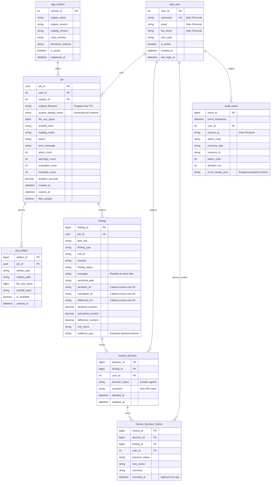

# Diseño de Despliegue Institucional, Modelo de Datos y Seguridad

Fecha de elaboración: 6 de octubre de 2026.  
Proyecto: **revisor-crf** · Módulo Web Interno Centralizado.  
Estado: **Documento de Diseño y Especificación Técnica para Aprobación Institucional**.

---

## 1. Resumen Ejecutivo y Alcance

El presente documento define la arquitectura técnica, el modelo de datos relacional para **Microsoft SQL Server**, el esquema de seguridad y privacidad, la estrategia de autenticación y autorización institucional, y la política de ciclo de vida de los datos para la versión centralizada del **Revisor de CRF**.

El objetivo es permitir la transición desde el prototipo MVP en memoria/disco hacia una plataforma corporativa multiusuario, auditable y segura, sin alterar la lógica interna determinística de `src/revisor_crf`.

```text
+-------------------------------------------------------------------------------+
|                       ARQUITECTURA DE TRES NIVELES                            |
+-------------------------------------------------------------------------------+
| 1. Nivel de Presentación / Perímetro:                                         |
|    - Navegador Web del Auditor (HTML5 / Vanilla JS accesible, sin CDNs).       |
|    - Proxy Inverso / IIS con Terminación TLS (HTTPS) y Autenticación.         |
+-------------------------------------------------------------------------------+
| 2. Nivel de Aplicación (Backend):                                             |
|    - API FastAPI en Python 3.11+ (Escucha estrictamente en 127.0.0.1:8000).   |
|    - Orquestador de trabajos y semáforo de concurrencia.                      |
|    - Motor determinístico revisor_crf (Procesamiento en memoria/hilos).       |
|    - Almacenamiento temporal efímero en disco (SSD/NVMe local).               |
+-------------------------------------------------------------------------------+
| 3. Nivel de Datos y Auditoría:                                                |
|    - Microsoft SQL Server 2019 / 2022 (Metadatos, decisiones, trazabilidad).  |
+-------------------------------------------------------------------------------+
```

---

## 2. Clasificación de Datos, Privacidad y Tratamiento de Información Personal

### 2.1. Reconocimiento Expreso de Datos Personales e Identificadores Institucionales
El sistema **no es un entorno anónimo**. Para garantizar la debida rendición de cuentas, la trazabilidad de autorías en revisiones de auditoría gubernamental y la seguridad informática institucional, el sistema recolecta y procesa identificadores corporativos y datos personales de los servidores públicos operadores:
- **`username` (Nombre de usuario institucional)**: Identificador único de red (`sAMAccountName` o UPN).
- **`full_name` (Nombre completo del auditor)**: Dato personal identificativo.
- **`email` (Correo electrónico institucional)**: Medio de contacto y notificación institucional.
- **`session_ip` (Dirección IP de origen)**: Dato personal indirecto / identificador de red para trazabilidad y seguridad perimetral.

**Finalidad y Fundamento Propuestos**: El tratamiento de estos datos personales se plantea bajo la finalidad de registrar la autoría y responsabilidad técnica de las revisiones y decisiones editoriales sobre informes de auditoría, así como la prevención de accesos no autorizados conforme a las políticas de seguridad de la información. **Esta finalidad y su fundamento quedan expresamente sujetos a validación formal por las áreas jurídica, de privacidad/datos personales, de archivo y de seguridad de la información institucional.**

### 2.2. Tabla de Clasificación de Datos del Sistema

| Tabla / Atributo | Tipo de Información | Clasificación de Sensibilidad | Finalidad / Justificación Propuesta | Retención Propuesta (Sujeta a Aprobación) | Control de Acceso (Roles) |
|---|---|---|---|---|---|
| `app_user.username`, `email`, `full_name` | Identidad del auditor | **Datos Personales / Interna** | Identificación unívoca del revisor y asignación de responsabilidad en auditorías. | Mientras la cuenta esté activa + 5 años tras baja. | Admin: Lectura/Gestión. Auditor Sistema: Lectura. |
| `audit_event.session_ip` | Identificador de red | **Datos Personales / Seguridad** | Detección de incidentes de seguridad y trazabilidad de peticiones. | 6 a 12 meses. | Auditor Sistema: Lectura. Admin: Lectura agregada. |
| Archivos DOCX subidos y generados | Documentos de trabajo de auditoría | **Confidencial / Reservada** | Análisis determinístico y descarga de entregables por el revisor. | **Efímera (30 min a 4 h)** en disco local; purga física irreversible. | Revisor propietario exclusivamente. |
| `job.sha256_hash`, `file_size_bytes` | Huellas de integridad | **Interna / Técnica** | Verificación de no alteración y detección de revisiones duplicadas. | 1 a 3 años. | Revisor (propios), Admin, Auditor Sistema. |
| `job.original_filename` | Nombre de archivo original | **Confidencial / Interna** | Referencia de trabajo para el usuario en sesión activa. | Temporal (mientras `files_purged = 0`); se anonimiza tras TTL. | Revisor propietario. |
| `job.system_display_name` | Nombre generado por el sistema | **Interna / Técnica** | Identificador neutral de interfaz (`Documento <8 chars UUID>`). | 90 a 365 días (igual que el trabajo). | Revisor (propios), Admin, Auditor Sistema. |
| `finding.declared_str`, `calculated_str`, `difference_str`, `unit_name` | Metadatos y cifras de cálculo | **Interna / Técnica** | Cuantificación de discrepancias aritméticas detectadas por las reglas. | 1 a 3 años (Calibración de reglas). | Revisor (propios), Admin (métricas), Auditor Sistema. |
| `finding.evidence_json` (Esquema estricto) | Estructura y coordenadas XML | **Interna / Técnica** | Soporte técnico y depuración de falsos positivos sin incluir texto documental. | 1 a 3 años. | Revisor (propios), Admin, Auditor Sistema. |
| `human_decision.decision_status` | Juicio del auditor vigente | **Interna / Auditoría** | Trazabilidad del criterio humano actual respecto a alertas emitidas. | 3 a 5 años (Dataset de mejora). | Revisor (propios), Admin (métricas), Auditor Sistema. |
| `human_decision_history` | Historial append-only de decisiones | **Interna / Auditoría** | Trazabilidad inmutable para la aplicación de cada cambio de juicio. | 3 a 5 años. | Revisor (propios), Auditor Sistema. |
| `human_decision.comment` | Justificación técnica en texto libre | **Confidencial / Interna** | Explicación del revisor sobre la confirmación o descarte de hallazgos. | 1 a 3 años (con límite de longitud y advertencia UI). | Revisor (propios), Auditor Sistema. |

### 2.3. Principio de No Almacenamiento de Texto Documental en Bruto y Validación Estricta de Evidencia
Para mitigar riesgos de fuga de información confidencial y cumplir con el principio de minimización de datos:
1. **Prohibición de Texto Narrativo en Base de Datos**: No se almacena el cuerpo del documento, párrafos completos, fragmentos libres de búsqueda (`search_text`) ni mensajes que contengan texto confidencial extraído del CRF.
2. **Plantillas Estructuradas de Mensajes**: El campo `message` en `crf.finding` utiliza descripciones genéricas de la regla (ej. `"Discrepancia en suma vertical de tabla: el total declarado no coincide con la suma de componentes."`).
3. **Validación Estricta en Backend y Limitación de `ISJSON()`**:
   - **Limitación de `ISJSON()` en SQL Server**: La función `ISJSON()` de SQL Server valida **únicamente la sintaxis** del texto como JSON válido; **no valida estructura, propiedades ni ausencia de texto documental**.
   - **Validación Estricta en Backend**: La lista blanca (*allowlist*) de propiedades para `evidence_json` y `event_details_json` debe validarse obligatoriamente en el backend (vía esquemas Pydantic / JSON Schema estrictos con `additionalProperties: false`) previo a su inserción en la base de datos:

```json
{
  "$schema": "https://json-schema.org/draft/2020-12/schema",
  "title": "AnonymizedTechnicalEvidence",
  "type": "object",
  "properties": {
    "rule_code": { "type": "string", "example": "NUM-TOTAL-001" },
    "source_path": { "type": "string", "example": "word/document.xml" },
    "element_id": { "type": "string", "example": "body/b0003/r0002/c0001" },
    "row_index": { "type": "integer", "example": 5 },
    "col_index": { "type": "integer", "example": 2 },
    "declared_str": { "type": "string", "example": "1250000.00" },
    "calculated_str": { "type": "string", "example": "1245000.00" },
    "difference_str": { "type": "string", "example": "-5000.00" },
    "unit": { "type": "string", "example": "miles_de_pesos" },
    "scale": { "type": "integer", "example": 1000 },
    "structural_hierarchy": {
      "type": "array",
      "items": { "type": "string" },
      "example": ["Resultado 1", "Tabla 2", "Fila 5"]
    }
  },
  "required": ["rule_code", "source_path", "element_id"],
  "additionalProperties": false
}
```

### 2.4. Protección de Comentarios Humanos en Texto Libre
Dado que los comentarios libres registrados por los revisores humanos (`crf.human_decision.comment`) podrían contener inadvertidamente nombres o fragmentos confidenciales:
- **Límite de Longitud**: Se restringe a un máximo de **500 caracteres** (`NVARCHAR(500)`).
- **Advertencia en Interfaz de Usuario (UI)**: La interfaz mostrará una leyenda visible:  
  *“Advertencia de Seguridad: Ingrese únicamente justificaciones metodológicas. No incluya datos personales sensibles ni fragmentos clasificados en este campo.”*
- **Ciclo de Vida Específico**: Los comentarios podrán ser objeto de disociación o purga programada sin afectar el estado estadístico de la decisión (`decision_status`).

### 2.5. Gestión Neutral de Nombres de Archivo (Sin Inferencia Automática)
- **Riesgo Identificado**: Intentar "sanitizar" o inferir mediante filtros heurísticos/regex si el nombre del archivo contiene nombres de personas, números de auditoría o expedientes clasificados es falible e inseguro.
- **Estrategia Adoptada**:
  - Para propósitos de despliegue general, listados y consultas operativas, el sistema genera de forma invariable y neutral un nombre determinístico:  
    `system_display_name` = `"Documento " + SUBSTRING(CAST(job_id AS VARCHAR(36)), 1, 8)` (ej. `"Documento 4a8f9c12"`).
  - El nombre original (`original_filename`) se preserva únicamente para referencia del propio revisor mientras los archivos residan en el almacenamiento efímero (`files_purged = 0`). Al vencer el TTL y purgarse el disco, `original_filename` pasa a `NULL` de manera automática e irreversible.

---

## 3. Modelo de Datos para Microsoft SQL Server

El modelo se estructura en un esquema dedicado denominado `crf` para aislar los objetos de la aplicación dentro de la base de datos institucional.

### 3.1. Definición de Tablas (DDL T-SQL)

```sql
-- Creación del esquema dedicado
CREATE SCHEMA crf;
GO

-- =============================================================================
-- 1. Versiones del Motor y Catálogos Editoriales
-- =============================================================================
CREATE TABLE crf.app_version (
    version_id          INT IDENTITY(1,1)   NOT NULL,
    engine_name         VARCHAR(50)         NOT NULL, -- 'revisor-crf-deterministic'
    engine_version      VARCHAR(20)         NOT NULL, -- '0.5.0'
    catalog_version     VARCHAR(50)         NOT NULL, -- '2IN2RE01-02-2025-partial-1'
    rules_schema        VARCHAR(20)         NOT NULL, -- 'review-1.1'
    decisions_schema    VARCHAR(20)         NOT NULL, -- 'review-decisions-1.2'
    is_active           BIT                 NOT NULL DEFAULT 1,
    registered_at       DATETIME2(3)        NOT NULL DEFAULT SYSUTCDATETIME(),
    
    CONSTRAINT PK_app_version PRIMARY KEY CLUSTERED (version_id),
    CONSTRAINT UQ_app_version_versions UNIQUE (engine_name, engine_version, catalog_version)
);

-- =============================================================================
-- 2. Usuarios del Sistema e Identificadores Institucionales
-- =============================================================================
CREATE TABLE crf.app_user (
    user_id             INT IDENTITY(1,1)   NOT NULL,
    username            NVARCHAR(100)       NOT NULL, -- sAMAccountName o UPN institucional (ej: 'ar_rodriguez')
    email               NVARCHAR(255)       NULL,     -- Correo institucional
    full_name           NVARCHAR(200)       NOT NULL, -- Nombre completo del servidor público
    role_code           VARCHAR(20)         NOT NULL, -- 'revisor', 'administrador', 'auditor_sistema'
    is_active           BIT                 NOT NULL DEFAULT 1,
    created_at          DATETIME2(3)        NOT NULL DEFAULT SYSUTCDATETIME(),
    last_login_at       DATETIME2(3)        NULL,
    
    CONSTRAINT PK_app_user PRIMARY KEY CLUSTERED (user_id),
    CONSTRAINT UQ_app_user_username UNIQUE (username),
    CONSTRAINT CK_app_user_role CHECK (role_code IN ('revisor', 'administrador', 'auditor_sistema'))
);

-- =============================================================================
-- 3. Trabajos de Revisión (Jobs)
-- =============================================================================
CREATE TABLE crf.job (
    job_id                  UNIQUEIDENTIFIER    NOT NULL, -- UUID v4 generado por el backend
    user_id                 INT                 NOT NULL,
    version_id              INT                 NOT NULL,
    
    -- Metadatos del archivo y privacidad
    original_filename       NVARCHAR(260)       NULL,     -- Conservado temporalmente mientras files_purged = 0; purgado tras TTL
    system_display_name     NVARCHAR(50)        NOT NULL, -- Nombre generado por el sistema: 'Documento ' + SUBSTRING(CAST(job_id AS VARCHAR(36)), 1, 8)
    file_size_bytes         BIGINT              NOT NULL,
    sha256_hash             CHAR(64)            NOT NULL, -- SHA-256 del DOCX original para integridad
    reading_mode            VARCHAR(10)         NOT NULL DEFAULT 'final', -- 'final', 'original', 'all'
    
    -- Estado y ciclo de vida del trabajo
    status                  VARCHAR(20)         NOT NULL DEFAULT 'recibido',
    error_message           NVARCHAR(500)       NULL,     -- Mensaje técnico sanitizado (sin rutas internas ni texto sensible)
    
    -- Métricas resumidas de la revisión determinística
    alerts_count            INT                 NULL,
    warnings_count          INT                 NULL,
    evaluated_count         INT                 NULL,
    excluded_count          INT                 NULL,
    duration_seconds        DECIMAL(8,3)        NULL,
    
    -- Fechas de auditoría y ciclo de vida efímero
    created_at              DATETIME2(3)        NOT NULL DEFAULT SYSUTCDATETIME(),
    started_at              DATETIME2(3)        NULL,
    finished_at             DATETIME2(3)        NULL,
    expires_at              DATETIME2(3)        NOT NULL, -- Marca temporal para purga de archivos físicos
    files_purged            BIT                 NOT NULL DEFAULT 0, -- 1 indica que los archivos en disco fueron eliminados
    
    CONSTRAINT PK_job PRIMARY KEY CLUSTERED (job_id),
    CONSTRAINT FK_job_user FOREIGN KEY (user_id) REFERENCES crf.app_user(user_id),
    CONSTRAINT FK_job_version FOREIGN KEY (version_id) REFERENCES crf.app_version(version_id),
    CONSTRAINT CK_job_status CHECK (status IN ('recibido', 'procesando', 'terminado', 'fallido')),
    CONSTRAINT CK_job_mode CHECK (reading_mode IN ('final', 'original', 'all'))
);

-- =============================================================================
-- 4. Artefactos Temporales Asociados al Trabajo
-- =============================================================================
CREATE TABLE crf.job_artifact (
    artifact_id         BIGINT IDENTITY(1,1) NOT NULL,
    job_id              UNIQUEIDENTIFIER     NOT NULL,
    artifact_type       VARCHAR(20)          NOT NULL, -- 'input_docx', 'report_json', 'report_html', 'commented_docx'
    relative_path       NVARCHAR(500)        NOT NULL, -- Ruta relativa al directorio de almacenamiento efímero
    file_size_bytes     BIGINT               NOT NULL,
    sha256_hash         CHAR(64)             NOT NULL,
    is_available        BIT                  NOT NULL DEFAULT 1, -- Pasa a 0 al expirar el TTL y purgarse el disco
    created_at          DATETIME2(3)         NOT NULL DEFAULT SYSUTCDATETIME(),
    
    CONSTRAINT PK_job_artifact PRIMARY KEY CLUSTERED (artifact_id),
    CONSTRAINT FK_job_artifact_job FOREIGN KEY (job_id) REFERENCES crf.job(job_id) ON DELETE CASCADE,
    CONSTRAINT UQ_job_artifact_type UNIQUE (job_id, artifact_type),
    CONSTRAINT CK_job_artifact_type CHECK (artifact_type IN ('input_docx', 'report_json', 'report_html', 'commented_docx'))
);

-- =============================================================================
-- 5. Hallazgos Estructurados (Sin Texto Documental en Bruto)
-- =============================================================================
CREATE TABLE crf.finding (
    finding_id          BIGINT IDENTITY(1,1) NOT NULL,
    job_id              UNIQUEIDENTIFIER     NOT NULL,
    item_key            VARCHAR(100)         NOT NULL, -- Identificador estructural (ej: 'body/b0003/r0002/c0001')
    finding_type        VARCHAR(30)          NOT NULL, -- 'alert', 'editorial_finding', 'semantic_suggestion'
    rule_id             VARCHAR(50)          NOT NULL, -- 'NUM-TOTAL-001', 'NUM-CROSS-001', 'DOC-OBS-001', etc.
    severity            VARCHAR(20)          NOT NULL, -- 'high', 'medium', 'low', 'error', 'warning', 'suggestion', 'info'
    finding_status      VARCHAR(30)          NOT NULL, -- 'possible', 'confirmed', 'requires_human_review'
    
    -- Mensaje descriptivo genérico y ubicación estructural
    message             NVARCHAR(500)        NOT NULL, -- Descripción estándar de la regla, sin fragmentos de texto
    structural_path     NVARCHAR(300)        NULL,     -- Ruta jerárquica (ej: 'Resultado 1 > Tabla 2 > Fila 3')
    
    -- Representación Canónica Exacta (Cadenas) para Preservar Precisión Arbitraria de Decimal
    -- Límite técnico: VARCHAR(50). Valores fuera de contrato deben rechazarse explícitamente en backend (HTTP 422), NUNCA truncarse.
    declared_str        VARCHAR(50)          NULL,
    calculated_str      VARCHAR(50)          NULL,
    difference_str      VARCHAR(50)          NULL,
    
    -- Columnas Numéricas Auxiliares para Consultas y Agregaciones SQL (Sin pérdida en rango estándar)
    declared_numeric    DECIMAL(38,10)       NULL,
    calculated_numeric  DECIMAL(38,10)       NULL,
    difference_numeric  DECIMAL(38,10)       NULL,
    unit_name           VARCHAR(50)          NULL,
    scale_multiplier    INT                  NULL,
    
    -- Evidencia técnica en formato JSON estructurado
    -- NOTA: ISJSON valida únicamente sintaxis. El esquema estricto (allowlist) se valida en backend con additionalProperties: false.
    evidence_json       NVARCHAR(MAX)        NOT NULL,
    created_at          DATETIME2(3)         NOT NULL DEFAULT SYSUTCDATETIME(),
    
    CONSTRAINT PK_finding PRIMARY KEY CLUSTERED (finding_id),
    CONSTRAINT FK_finding_job FOREIGN KEY (job_id) REFERENCES crf.job(job_id) ON DELETE CASCADE,
    CONSTRAINT CK_finding_type CHECK (finding_type IN ('alert', 'editorial_finding', 'semantic_suggestion')),
    CONSTRAINT CK_finding_severity CHECK (severity IN ('high', 'medium', 'low', 'error', 'warning', 'suggestion', 'info')),
    CONSTRAINT CK_finding_evidence_json CHECK (ISJSON(evidence_json) = 1)
);

-- =============================================================================
-- 6. Decisiones Humanas (Estado Vigente Actual)
-- =============================================================================
CREATE TABLE crf.human_decision (
    decision_id         BIGINT IDENTITY(1,1) NOT NULL,
    finding_id          BIGINT               NOT NULL,
    user_id             INT                  NOT NULL,
    decision_status     VARCHAR(30)          NOT NULL, -- 'pending', 'confirmed', 'rejected', 'not_evaluable', 'audit_team_review'
    comment             NVARCHAR(500)        NULL,     -- Justificación metodológica breve (con advertencia en UI)
    decided_at          DATETIME2(3)         NOT NULL DEFAULT SYSUTCDATETIME(),
    updated_at          DATETIME2(3)         NOT NULL DEFAULT SYSUTCDATETIME(),
    
    CONSTRAINT PK_human_decision PRIMARY KEY CLUSTERED (decision_id),
    CONSTRAINT FK_human_decision_finding FOREIGN KEY (finding_id) REFERENCES crf.finding(finding_id) ON DELETE CASCADE,
    CONSTRAINT FK_human_decision_user FOREIGN KEY (user_id) REFERENCES crf.app_user(user_id),
    CONSTRAINT UQ_human_decision_finding UNIQUE (finding_id),
    CONSTRAINT CK_human_decision_status CHECK (decision_status IN ('pending', 'confirmed', 'rejected', 'not_evaluable', 'audit_team_review'))
);

-- =============================================================================
-- 7. Historial de Decisiones Humanas (Bitácora Append-Only para la Aplicación)
-- =============================================================================
CREATE TABLE crf.human_decision_history (
    history_id          BIGINT IDENTITY(1,1) NOT NULL,
    decision_id         BIGINT               NOT NULL,
    finding_id          BIGINT               NOT NULL,
    user_id             INT                  NOT NULL,
    previous_status     VARCHAR(30)          NULL,     -- Estado previo ('pending', 'confirmed', etc. o NULL al crearse)
    new_status          VARCHAR(30)          NOT NULL, -- Estado resultante
    comment             NVARCHAR(500)        NULL,     -- Comentario asociado a la transición
    recorded_at         DATETIME2(3)         NOT NULL DEFAULT SYSUTCDATETIME(),
    
    CONSTRAINT PK_human_decision_history PRIMARY KEY CLUSTERED (history_id),
    CONSTRAINT FK_human_decision_history_decision FOREIGN KEY (decision_id) REFERENCES crf.human_decision(decision_id) ON DELETE CASCADE,
    CONSTRAINT FK_human_decision_history_finding FOREIGN KEY (finding_id) REFERENCES crf.finding(finding_id),
    CONSTRAINT FK_human_decision_history_user FOREIGN KEY (user_id) REFERENCES crf.app_user(user_id),
    CONSTRAINT CK_decision_history_prev_status CHECK (previous_status IS NULL OR previous_status IN ('pending', 'confirmed', 'rejected', 'not_evaluable', 'audit_team_review')),
    CONSTRAINT CK_decision_history_new_status CHECK (new_status IN ('pending', 'confirmed', 'rejected', 'not_evaluable', 'audit_team_review'))
);

-- =============================================================================
-- 8. Pistas de Auditoría y Eventos de Seguridad (Bitácora Append-Only para la Aplicación)
-- =============================================================================
CREATE TABLE crf.audit_event (
    event_id            BIGINT IDENTITY(1,1) NOT NULL,
    event_timestamp     DATETIME2(3)         NOT NULL DEFAULT SYSUTCDATETIME(),
    user_id             INT                  NULL,     -- NULL si es evento previo a autenticación o tarea del sistema
    session_ip          VARCHAR(45)          NOT NULL, -- IPv4 o IPv6 de origen
    action_code         VARCHAR(50)          NOT NULL, -- 'UPLOAD', 'REVIEW_COMPLETE', 'DOWNLOAD_REPORT', 'RECORD_DECISION', etc.
    resource_type       VARCHAR(30)          NOT NULL, -- 'JOB', 'FINDING', 'USER', 'SYSTEM'
    resource_id         VARCHAR(50)          NULL,     -- job_id o entity_id
    status_code         INT                  NOT NULL, -- Código HTTP (200, 202, 400, 401, 403, 500, etc.)
    duration_ms         INT                  NULL,
    event_details_json  NVARCHAR(MAX)        NULL,     -- Metadatos técnicos estructurados (NUNCA texto documental; ISJSON valida sintaxis)
    
    CONSTRAINT PK_audit_event PRIMARY KEY CLUSTERED (event_id),
    CONSTRAINT FK_audit_event_user FOREIGN KEY (user_id) REFERENCES crf.app_user(user_id),
    CONSTRAINT CK_audit_event_details_json CHECK (event_details_json IS NULL OR ISJSON(event_details_json) = 1)
);
GO
```

### 3.2. Índices Estratégicos de Rendimiento y Búsqueda

```sql
-- Listado de trabajos por usuario y orden cronológico
CREATE NONCLUSTERED INDEX IX_job_user_created 
ON crf.job (user_id, created_at DESC) 
INCLUDE (status, system_display_name, alerts_count, expires_at, files_purged);

-- Detección de revisiones previas por huella SHA-256
CREATE NONCLUSTERED INDEX IX_job_sha256 
ON crf.job (sha256_hash) 
INCLUDE (job_id, status, created_at);

-- Tarea de purga por TTL (trabajos cuyos archivos físicos requieren eliminación)
CREATE NONCLUSTERED INDEX IX_job_ttl_purge 
ON crf.job (expires_at, files_purged) 
WHERE files_purged = 0;

-- Búsqueda de hallazgos por trabajo, severidad y tipo de regla
CREATE NONCLUSTERED INDEX IX_finding_job_severity 
ON crf.finding (job_id, severity, rule_id);

-- Consultas de historial de decisiones por hallazgo
CREATE NONCLUSTERED INDEX IX_human_decision_history_finding 
ON crf.human_decision_history (finding_id, recorded_at DESC);

-- Consultas de pistas de auditoría por rango de fechas y tipo de acción
CREATE NONCLUSTERED INDEX IX_audit_event_timestamp_action 
ON crf.audit_event (event_timestamp DESC, action_code) 
INCLUDE (user_id, session_ip, status_code);
GO
```

---

## 4. Diagrama Entidad-Relación



---

## 5. Política de Retención, Ciclo de Vida y Purga de Datos

Los plazos de retención propuestos a continuación se encuentran estructurados por categoría de información y **requieren validación y aprobación formal expresa** por parte de las direcciones de **Tecnologías de la Información**, **Ciberseguridad y Seguridad de la Información**, y la **Unidad de Archivo Institucional**:

```text
+-----------------------------------------------------------------------------------------------+
|                       VENTANAS DE RETENCIÓN DIFERENCIADAS                                     |
+-----------------------------------------------------------------------------------------------+
| 1. Archivos Físicos Efímeros (Disco Local SSD):                                               |
|    - DOCX subido, DOCX comentado, JSON, HTML: 30 minutos a 4 horas (TTL).                     |
|    - Al vencer: Eliminación física irreversible (unlink) y marcado files_purged = 1.         |
|                                                                                               |
| 2. Metadatos de Trabajos (SQL Server):                                                        |
|    - job, job_artifact: 90 a 365 días (propuesta configurable).                               |
|    - Permite supervisión de volumen operativo sin conservar documentos.                      |
|                                                                                               |
| 3. Hallazgos y Decisiones Humanas (SQL Server):                                               |
|    - finding, human_decision, human_decision_history: 1 a 3 años.                             |
|    - Justificación: Calibración continua de reglas determinísticas y prevención de sesgos.   |
|                                                                                               |
| 4. Comentarios en Texto Libre (SQL Server):                                                   |
|    - human_decision.comment: 1 año o anonimización periódica.                                 |
|                                                                                               |
| 5. Pistas de Auditoría y Registros de IP (SQL Server):                                        |
|    - audit_event, session_ip: 6 a 12 meses conforme a normas de ciberseguridad.              |
+-----------------------------------------------------------------------------------------------+
```

### 5.1. Mecanismo Automatizado de Purga de Archivos
1. Una tarea periódica en segundo plano en FastAPI ejecuta la verificación de vencimiento cada `REVISOR_WEB_CLEANUP_INTERVAL_SECONDS` (por defecto 60 segundos).
2. Identifica registros en `crf.job` donde `expires_at <= SYSUTCDATETIME()` y `files_purged = 0` y `status != 'procesando'`.
3. Elimina de manera segura la carpeta física del trabajo en disco.
4. Actualiza en SQL Server:
   - `crf.job.files_purged = 1`
   - `crf.job.original_filename = NULL` (anonimización del nombre original para evitar fuga de expedientes)
   - `crf.job_artifact.is_available = 0`

---

## 6. Diseño de Autenticación Institucional y Protección de Perímetro

```text
+---------------------------------------------------------------------------------------+
|                OPCIONES DE AUTENTICACIÓN INSTITUCIONAL EVALUADAS                      |
+---------------------------------------------------------------------------------------+
| [Opción A] (Estándar Intranet): IIS Reverse Proxy + Windows Integrated Auth (Kerberos)|
| [Opción B] (Estándar Nube/M365): Microsoft Entra ID (OIDC / OAuth 2.0 con JWT)        |
| [Opción C] (Contingencia Excepcional): Autenticación Local Cifrada (Sujeta a Aval TI) |
+---------------------------------------------------------------------------------------+
```

### 6.1. Opción A: IIS con Autenticación Integrada de Windows (WIA / Kerberos / NTLM) - **Recomendada para Intranet**
1. **Flujo de Petición e Inyección de Identidad**:
   - El navegador del auditor se conecta mediante HTTPS (puerto 443) a IIS.
   - IIS autentica al usuario de forma transparente vía Kerberos / NTLM contra Active Directory.
   - **Mecanismo de Seguridad Anti-Suplantación (Anti-Spoofing)**:
     - IIS **debe eliminar obligatoriamente (`strip`) cualquier cabecera `X-Forwarded-User`, `X-Forwarded-Proto` o `X-Forwarded-For`** enviada por el cliente.
     - El módulo ARR (Application Request Routing) genera una cabecera nueva y fidedigna basada en la variable de servidor `{AUTH_USER}` o `{LOGON_USER}` (ej. `DOMINIO\ar_rodriguez`).
2. **Aislamiento de Red del Backend FastAPI**:
   - El proceso FastAPI se enlaza estrictamente a `127.0.0.1:8000` (loopback local).
   - Queda prohibido enlazar a `0.0.0.0` para evitar que usuarios en la red interna eludan a IIS e inyecten cabeceras falsificadas directamente al backend.
   - FastAPI valida que la conexión entrante proceda exclusivamente de `127.0.0.1`.

### 6.2. Opción B: Microsoft Entra ID (Azure AD / OIDC) - **Recomendada para Entornos Híbridos o Microsoft 365**
1. Registro de la aplicación web en el tenant institucional de Entra ID.
2. El usuario inicia sesión mediante Single Sign-On institucional con MFA obligatorio.
3. El frontend / backend recibe un ID Token JWT firmado por Microsoft.
4. FastAPI valida criptográficamente la firma del token mediante las claves públicas institucionales JWKS (`https://login.microsoftonline.com/{tenant_id}/discovery/v2.0/keys`), verificando `aud`, `iss` y vigencia `exp`.
5. Se extraen los claims institucionales: `preferred_username`, `email`, `name` y `roles`.

### 6.3. Opción C: Autenticación Local por Sesión - **Contingencia Excepcional para Laboratorios Aislados**
> [!WARNING]
> La autenticación mediante credenciales locales (usuario y contraseña en base de datos) **no es un método estándar corporativo**. Se define exclusivamente como una **medida de contingencia temporal o de laboratorio desconectado**, y su habilitación en producción requerirá **autorización previa y expresa de la Dirección de Seguridad de la Información**.

- En caso de autorizarse, las contraseñas se almacenarán mediante hash **Argon2id** o **PBKDF2-HMAC-SHA256** (mínimo 600,000 iteraciones) con salt criptográfico individual.
- Cookies de sesión firmadas con atributos `HttpOnly`, `Secure`, `SameSite=Lax` y tiempo de inactividad de 15 minutos.

---

## 7. Modelo de Autorización y Control de Acceso Basado en Roles (RBAC Refinado)

### 7.1. Definición de Roles Institucionales

| Rol | Código | Propósito Institucional y Alcance |
|---|---|---|
| **Revisor** | `revisor` | Auditor o revisor técnico. Carga documentos, consulta sus propios resultados, descarga sus entregables y registra decisiones metodológicas sobre los hallazgos de sus trabajos. |
| **Administrador** | `administrador` | Personal de TI / Soporte Operativo. Supervisa métricas de concurrencia, salud del servidor, colas y catálogos de reglas. **No tiene acceso por defecto a visualizar contenido documental ni descargar entregables de terceros.** |
| **Auditor de Sistema** | `auditor_sistema` | Órgano Interno de Control / Seguridad de la Información. Supervisa la bitácora append-only de eventos (`audit_event`) y de decisiones (`human_decision_history`), métricas globales y cumplimiento normativo. **No tiene acceso por defecto a descargar documentos de terceros.** |

### 7.2. Matriz de Permisos

| Acción / Recurso | Revisor | Administrador | Auditor de Sistema |
|---|:---:|:---:|:---:|
| Cargar DOCX y procesar revisión | **SÍ** | **SÍ** (para pruebas) | No |
| Ver estado y métricas de **sus propios trabajos** | **SÍ** | **SÍ** | **SÍ** (si creó alguno) |
| Ver lista y estado operativo de **trabajos de terceros** | No | **SÍ** (solo metadatos técnicos) | **SÍ** (solo metadatos de auditoría) |
| Descargar JSON, HTML o DOCX comentado **propios** | **SÍ** | **SÍ** | **SÍ** |
| Descargar JSON, HTML o DOCX comentado **de terceros** | **No** | **No** (Restringido por privacidad) | **No** (Restringido por privacidad) |
| Registrar / modificar decisiones en hallazgos propios | **SÍ** | No | No |
| Cancelar / eliminar trabajos propios en cola | **SÍ** | **SÍ** | No |
| Purgar trabajos o archivos huérfanos del sistema | No | **SÍ** (Operativo) | No |
| Consultar bitácora append-only (`crf.audit_event`, `crf.human_decision_history`) | No | No | **SÍ** |
| Gestionar versiones de motor y catálogo de reglas | No | **SÍ** | No |
| Gestionar asignación de roles de usuarios | No | **SÍ** | No |

### 7.3. Aislamiento Multi-usuario en Base de Datos (Tenancy por Usuario)

Para evitar la fuga de información entre auditores, el backend aplica filtros obligatorios parametrizados según el rol del usuario autenticado:

```sql
-- 1. Consulta para rol 'revisor' (Aislamiento estricto de sus propios trabajos)
SELECT job_id, system_display_name, status, alerts_count, warnings_count, 
       created_at, expires_at, files_purged
FROM crf.job 
WHERE user_id = @current_user_id 
ORDER BY created_at DESC;

-- 2. Consulta para rol 'administrador' (Supervisión operativa sin exponer nombres originales ni descargas ajenas)
SELECT job_id, user_id, system_display_name, status, alerts_count, duration_seconds, 
       created_at, expires_at, files_purged
FROM crf.job 
ORDER BY created_at DESC;

-- 3. Consulta para descarga de artefactos (Verificación estricta de propiedad)
SELECT relative_path, is_available 
FROM crf.job_artifact a
INNER JOIN crf.job j ON a.job_id = j.job_id
WHERE a.job_id = @requested_job_id 
  AND a.artifact_type = @requested_type 
  AND (j.user_id = @current_user_id OR @user_role = 'administrador_con_custodia_autorizada');
```

---

## 8. Seguridad, Mínimo Privilegio y Buenas Prácticas en Microsoft SQL Server

### 8.1. Cuenta de Servicio con Mínimo Privilegio y Bitácora Append-Only para la Aplicación
La aplicación web operará bajo la cuenta de servicio dedicada `svc_revisor_crf`, aplicando el principio de mínimo privilegio y garantizando que la aplicación únicamente pueda añadir registros en las bitácoras de auditoría e historial:

```sql
-- Creación del usuario en la base de datos
CREATE USER [svc_revisor_crf] FOR LOGIN [svc_revisor_crf];
GO

-- Concesión de permisos operativos en tablas de trabajo y decisiones vigentes
GRANT SELECT, INSERT, UPDATE, DELETE ON crf.job TO [svc_revisor_crf];
GRANT SELECT, INSERT, UPDATE, DELETE ON crf.job_artifact TO [svc_revisor_crf];
GRANT SELECT, INSERT, UPDATE, DELETE ON crf.finding TO [svc_revisor_crf];
GRANT SELECT, INSERT, UPDATE, DELETE ON crf.human_decision TO [svc_revisor_crf];
GRANT SELECT, INSERT, UPDATE ON crf.app_user TO [svc_revisor_crf];
GRANT SELECT ON crf.app_version TO [svc_revisor_crf];

-- Concesión de permisos APPEND-ONLY para la Cuenta de Aplicación en Bitácoras Históricas
-- La aplicación puede registrar eventos y transiciones, pero tiene PROHIBIDO modificar o borrar registros
GRANT SELECT, INSERT ON crf.human_decision_history TO [svc_revisor_crf];
DENY UPDATE, DELETE ON crf.human_decision_history TO [svc_revisor_crf];

GRANT SELECT, INSERT ON crf.audit_event TO [svc_revisor_crf];
DENY UPDATE, DELETE ON crf.audit_event TO [svc_revisor_crf];

-- Denegación explícita de privilegios administrativos
DENY CONTROL ON DATABASE::[BD_AUDITORIA_CRF] TO [svc_revisor_crf];
GO
```

### 8.2. Reconocimiento de Facultades de Administradores de SQL Server y Auditoría Institucional
> [!IMPORTANT]
> El esquema anterior garantiza que la **cuenta de la aplicación (`svc_revisor_crf`)** funcione bajo un esquema estricto de *Append-Only* (sin permisos de `UPDATE` o `DELETE`).  
> Sin embargo, se reconoce técnicamente que los **administradores de base de datos autorizados (DBA / sysadmin)** mantienen facultades administrativas plenas sobre el motor de SQL Server. Por ende, las acciones administrativas de alto nivel no son inmutables por sí solas y **deben quedar sujetas a los mecanismos de auditoría y control institucional**:
> 1. **SQL Server Audit**: Registro de eventos a nivel de servidor e instancia hacia bitácoras de eventos de Windows / archivos binarios protegidos.
> 2. **Integración con SIEM Corporativo**: Envío en tiempo real de logs de auditoría a la plataforma central de ciberseguridad institucional.
> 3. **Respaldos Protegidos (WORM)**: Almacenamiento de respaldos en repositorios de sólo lectura (Write Once, Read Many) para impedir alteraciones posteriores.

### 8.3. Cifrado de Conexión en Tránsito
La cadena de conexión forzará cifrado TLS mediante el driver oficial:
```text
Driver={ODBC Driver 18 for SQL Server};Server=sql-prod.institucion.gob.mx,1433;Database=BD_AUDITORIA_CRF;UID=svc_revisor_crf;PWD=***;Encrypt=yes;TrustServerCertificate=no;Connection Timeout=30;
```
- `Encrypt=yes`: Negociación TLS 1.2 / 1.3 obligatoria.
- `TrustServerCertificate=no`: Verificación obligatoria del certificado contra la Autoridad Certificadora (CA) institucional.

### 8.4. Estrategia de Respaldos y Continuidad
1. **Modelo de Recuperación**: `FULL` (Permite restauración a un punto en el tiempo ante fallos lógicos o incidentes).
2. **Calendario de Respaldos**:
   - **Completo (Full)**: Diario a las 01:00 hrs (Retención: 30 días).
   - **Diferencial**: Cada 6 horas (07:00, 13:00, 19:00 hrs).
   - **Log de Transacciones**: Cada 15 minutos (Retención: 7 días).
3. **Separación de Ambientes**:
   - **Desarrollo**: Instancia local / SQL Express (`BD_CRF_DEV`).
   - **Calibración y Pruebas (QA)**: Instancia de pruebas con datos sintéticos (`BD_CRF_QA`).
   - **Producción**: Clúster corporativo de alta disponibilidad (`BD_CRF_PROD`).

---

## 9. Estrategia de Almacenamiento Híbrido, Resiliencia y Recuperación ante Fallos

```text
+-------------------------------------------------------------------------------+
|                       ESTRATEGIA DE ALMACENAMIENTO HÍBRIDO                    |
+-------------------------------------------------------------------------------+
| [Almacenamiento Relacional (SQL Server)]                                      |
|  - Metadatos de trabajos, conteos, duraciones y hashes SHA-256.               |
|  - Hallazgos técnicos estructurados (cálculos, rutas XML, evidencia JSON).    |
|  - Decisiones humanas y justificaciones metodológicas (vigentes e histórico). |
|  - Bitácora append-only de auditoría para la aplicación.                     |
+-------------------------------------------------------------------------------+
| [Almacenamiento Temporal Efímero (Disco Local SSD / NVMe)]                    |
|  - Estructura: <BASE_JOBS_DIR>/<job_uuid>/                                    |
|      * input.docx                                                             |
|      * report.json                                                            |
|      * report.html                                                            |
|      * commented.docx                                                         |
|  - Purgado físico irrecuperable al vencer TTL (30 min - 4 h).                 |
+-------------------------------------------------------------------------------+
```

### 9.1. Recuperación ante Reinicios Inesperados (Crash Recovery)
Si el servidor backend experimenta un reinicio o corte de energía imprevisto mientras existían trabajos en ejecución:
1. Durante el arranque del backend (`lifespan startup`), se ejecuta un barrido automático en SQL Server:
   ```sql
   UPDATE crf.job 
   SET status = 'fallido', 
       error_message = 'El procesamiento fue interrumpido por un reinicio imprevisto del servicio.' 
   WHERE status IN ('recibido', 'procesando');
   ```
2. Se realiza un saneamiento del sistema de archivos local para eliminar directorios huérfanos no finalizados.

---

## 10. Plan de Migraciones y Versionado de Base de Datos

Para garantizar la evolución controlada del esquema sin discrepancias entre ambientes:

1. **Herramienta**: **Alembic** sobre **SQLAlchemy** (dialecto `mssql+pyodbc`).
2. **Convención y Orden**:
   - Migraciones secuenciales en `migrations/versions/` (ej. `001_initial_schema.py`, `002_add_json_constraints.py`, `003_add_decision_history.py`).
3. **Realismo y Gestión de Rollbacks**:
   - Las migraciones deben diseñarse para ser **repetibles en ambientes limpios**.
   - **Reconocimiento Técnico**: Se reconoce que no toda migración en producción es 100% reversible sin impacto en datos (por ejemplo, eliminaciones o transformaciones de columnas con datos históricos). Por ello:
     - Todo despliegue de migración en producción requiere un **respaldo completo previo de la base de datos**.
     - Las migraciones deben probarse exhaustivamente en el ambiente de QA antes de su pase a Producción.
4. **Flujo de Ejecución**:
   ```powershell
   # Aplicación controlada de cambios en el esquema
   alembic upgrade head
   ```

---

## 11. Variables de Entorno Requeridas (Plantilla sin Secretos)

```ini
# ==============================================================================
# CONFIGURACIÓN DEL SERVIDOR Y RED
# ==============================================================================
REVISOR_WEB_HOST=127.0.0.1
REVISOR_WEB_PORT=8000
REVISOR_WEB_ENVIRONMENT=production # development, testing, production

# ==============================================================================
# CONEXIÓN A BASE DE DATOS (SQL SERVER)
# ==============================================================================
# Formato: mssql+pyodbc://<USER>:<PASSWORD>@<HOST>:<PORT>/<DB_NAME>?driver=ODBC+Driver+18+for+SQL+Server&TrustServerCertificate=no&Encrypt=yes
CRF_DB_DRIVER=ODBC Driver 18 for SQL Server
CRF_DB_SERVER=sql-crf.institucion.local
CRF_DB_PORT=1433
CRF_DB_NAME=BD_AUDITORIA_CRF
CRF_DB_USER=svc_revisor_crf
CRF_DB_PASSWORD=__DEFINIR_EN_KEY_VAULT_O_SECRETO_SEGURO__
CRF_DB_ENCRYPT=yes
CRF_DB_TRUST_SERVER_CERT=no

# ==============================================================================
# AUTENTICACIÓN INSTITUCIONAL
# ==============================================================================
# Opciones estándar: 'windows_header', 'entra_id' | Contingencia: 'local_session'
CRF_AUTH_PROVIDER=windows_header

# Configuración si se usa Entra ID (OIDC / OAuth 2.0)
CRF_ENTRA_TENANT_ID=00000000-0000-0000-0000-000000000000
CRF_ENTRA_CLIENT_ID=00000000-0000-0000-0000-000000000000
CRF_ENTRA_CLIENT_SECRET=__DEFINIR_EN_SECRETO_SEGURO__

# Configuración si se usa IIS Reverse Proxy (Windows Integrated Auth)
CRF_TRUSTED_PROXY_IPS=127.0.0.1,::1
CRF_PROXY_USER_HEADER=X-Forwarded-User

# ==============================================================================
# LÍMITES OPERATIVOS Y ALMACENAMIENTO EFÍMERO
# ==============================================================================
REVISOR_WEB_MAX_FILE_SIZE_MB=25
REVISOR_WEB_JOB_TTL_SECONDS=1800
REVISOR_WEB_CLEANUP_INTERVAL_SECONDS=60
REVISOR_WEB_MAX_CONCURRENT_JOBS=2
REVISOR_WEB_MAX_QUEUE_SIZE=4
REVISOR_WEB_JOBS_DIR=D:\revisor_crf_runtime\jobs_temp
```

---

## 12. Cuestionario Técnico para las Áreas de TI, Ciberseguridad y Normatividad

Previo a la codificación de los conectores de base de datos y la configuración del proxy de producción, se debe formalizar el siguiente cuestionario ante las áreas correspondientes:

### A. Base de Datos (SQL Server)
1. **Versión y Edición**: ¿Qué versión y edición de SQL Server se encuentra disponible (ej. SQL Server 2019/2022 Standard/Enterprise)?
2. **Aprovisionamiento**: ¿TI creará una base de datos exclusiva (`BD_AUDITORIA_CRF`) con esquema `crf`, o se integrará en una instancia compartida?
3. **Mecanismo de Autenticación de BD**: ¿Se prefiere autenticación mediante **Managed Identity / Cuenta de Dominio de Windows (gMSA)** o mediante **SQL Server Authentication (Usuario/Contraseña)**?
4. **Certificados TLS**: ¿La instancia de SQL Server cuenta con certificado emitido por la CA institucional para habilitar `TrustServerCertificate=no`?
5. **Drivers en el Servidor**: ¿Se encuentra instalado `ODBC Driver 18 for SQL Server` en el servidor de aplicación?

### B. Directorio Activo, Identidad y Privacidad
6. **Mecanismo de Identidad Estándar**: ¿Se utilizará **IIS con WIA (Kerberos/NTLM)** o **Microsoft Entra ID (OIDC / OAuth 2.0)**?
7. **Atributos de Usuario Disponibles**: ¿El proveedor de identidad suministra el identificador de cuenta (`sAMAccountName`), correo institucional y nombre completo en las cabeceras/claims?
8. **Asignación de Roles**: ¿Los roles (`revisor`, `administrador`, `auditor_sistema`) se asignarán mediante **Grupos de Seguridad de Active Directory** (ej. `GRP_CRF_REVISORES`) o en la tabla de usuarios de la aplicación?
9. **Validación de Política de Retención y Finalidad**: ¿La finalidad, el fundamento legal y las ventanas de retención propuestas (30 min a 4 h para archivos efímeros; 1 a 3 años para hallazgos/decisiones; 6 a 12 meses para IPs) cuentan con la aprobación preliminar de las áreas Jurídica, de Privacidad/Datos Personales, Archivo Institucional y Ciberseguridad?

### C. Servidor Web, Red y Seguridad Perimetral
10. **Proxy Inverso**: ¿Se utilizará **IIS (con URL Rewrite y ARR)** o un balanceador corporativo (F5, Nginx) para la terminación HTTPS?
11. **Configuración Anti-Spoofing en IIS**: ¿Se cuenta con confirmación de que IIS eliminará cualquier cabecera `X-Forwarded-User` entrante desde la red antes de inyectar la cabecera auténtica?
12. **Certificado HTTPS**: ¿El certificado SSL/TLS del dominio institucional (ej. `https://revisor-crf.institucion.gob.mx`) ya se encuentra emitido y asignado?
13. **Límites de Red / WAF**: ¿El firewall de aplicaciones (WAF) permite cargas multipart de hasta 25 MB y timeouts de al menos 120 segundos?

### D. Almacenamiento Efímero y Antivirus
14. **Unidad de Disco Rápido**: ¿Se dispone de un volumen SSD/NVMe dedicado (ej. unidad `D:\` con al menos 20 GB libres) para los archivos efímeros de trabajo?
15. **Exclusiones de Antivirus / EDR**: ¿Es necesario tramitar exclusiones temporales en el antivirus corporativo (Defender / CrowdStrike / SentinelOne) para la carpeta `jobs_temp` a fin de evitar bloqueos de archivo durante la inspección de Word?

---

## 13. Decisiones Abiertas y Próximos Pasos

1. **Desacoplamiento Mediante Patrón Repositorio**:
   - Mantener el backend desacoplado definiendo interfaces abstractas (`IJobRepository`, `IFindingRepository`, `IDecisionRepository`, `IAuditRepository`). Esto permitirá que el MVP continúe funcionando en modo local (in-memory / SQLite) y se conecte a SQL Server en producción sin modificar la lógica de los controladores FastAPI.
2. **Validación Estricta de Cadenas Numéricas y Esquemas JSON**:
   - En el backend, implementar validadores estrictos que rechacen explícitamente (HTTP 422) cualquier cadena decimal que exceda los 50 caracteres o que no coincida con el formato canónico, garantizando que nunca se produzca truncamiento silencioso de datos.
   - Implementar validadores Pydantic / JSON Schema con `additionalProperties: false` para asegurar que `evidence_json` y `event_details_json` cumplan estrictamente con las propiedades permitidas sin texto documental libre.
3. **Condicionamiento de Implementación**:
   - **No iniciar la codificación de dependencias de base de datos (`pyodbc`, `SQLAlchemy`, `Alembic`) ni el conector de SQL Server** hasta recibir la respuesta formal al Cuestionario Técnico de la Sección 12.
